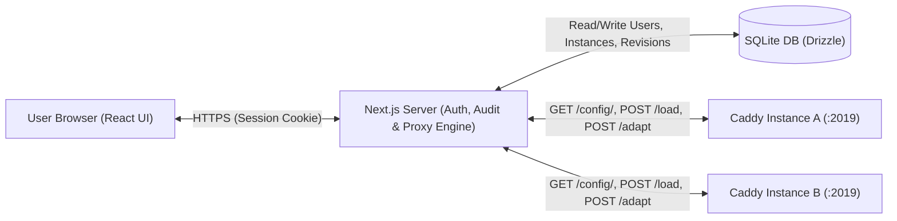
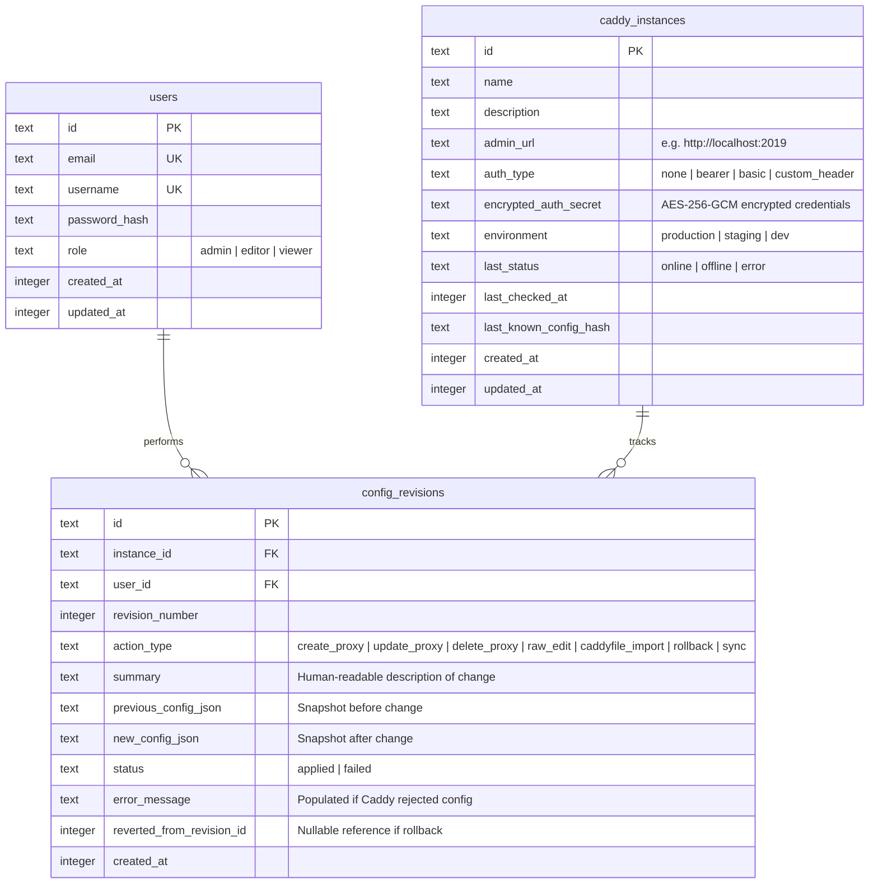

# Caddy Manager — Architecture & Development Roadmap

## 1. Technology Stack Specification

| Layer | Technology | Rationale |
| :--- | :--- | :--- |
| **Framework** | **Next.js (App Router, TypeScript)** | Unified full-stack architecture, Server Actions & Route Handlers for proxying requests to Caddy instances safely from the server. |
| **Database & ORM** | **SQLite (`better-sqlite3`) + Drizzle ORM** | Zero-configuration single-file persistence, fast synchronous driver, type-safe SQL queries, and automatic schema migrations (`drizzle-kit`). |
| **Authentication** | **Session Auth (`jose` JWT HTTP-only cookies + `bcryptjs` / `@node-rs/argon2`)** | Lightweight, self-contained credential authentication with initial admin setup/bootstrap flow. |
| **UI & Styling** | **Tailwind CSS + shadcn/ui + Lucide Icons** | Accessible, clean dashboard components (dialogs, tables, tabs, badges, sheets). |
| **Forms & Validation** | **React Hook Form + Zod** | End-to-end validation shared between client forms and server API routes. |
| **Code & Diff Viewer** | **Monaco Editor (`@monaco-editor/react`)** | Rich JSON/Caddyfile viewing, editing, syntax validation, and side-by-side audit diff comparison (`DiffEditor`). |
| **Encryption** | **Node.js `crypto` (AES-256-GCM)** | Encrypts Caddy instance authentication headers/tokens or mTLS keys at rest in SQLite. |

---

## 2. System Architecture & Data Flow

> [!IMPORTANT]
> **Atomic Updates & Drift Detection:** Whenever a user modifies a configuration (e.g., adds a reverse proxy route), the Next.js backend:
> 1. Fetches the **live** config from Caddy (`GET /config/`).
> 2. Compares its hash with the latest known revision in SQLite to detect any out-of-band changes ("drift").
> 3. Applies the transformation to the JSON config tree.
> 4. Sends the updated config to Caddy via `POST /load` (Caddy validates and atomically reloads the configuration; if invalid, Caddy rejects it with a descriptive error without dropping existing traffic).
> 5. Saves a new `config_revisions` audit record with `previous_config`, `new_config`, user info, and human-readable summary.

---

## 3. Database Schema (Drizzle ORM + SQLite)

---

## 4. How Caddy JSON Config is Managed

Caddy's configuration lives under `apps.http.servers.<server_name>.routes[]`.
To make the UI intuitive while preserving full compatibility with existing Caddy setups:
- **Managed Route Tagging (`@id`)**: Caddy natively supports an `@id` property on any JSON object in its config tree. When Caddy Manager creates or edits a Reverse Proxy route, it assigns a deterministic `@id` (e.g., `cm-route-<uuid>`) so it can cleanly identify, display, update, or delete managed routes while still displaying unmanaged routes safely.
- **Reverse Proxy Builder Features**:
  - **Domain / Host Matchers** (e.g., `app.example.com`, `*.example.com`, optional path matchers `/api/*`)
  - **Upstreams** (one or multiple backend targets like `127.0.0.1:8080`, `10.0.0.5:3000` with load-balancing policy selection: round-robin, least_conn, ip_hash, first)
  - **TLS / HTTPS Options** (Auto HTTPS via Let's Encrypt, internal self-signed TLS, or HTTP-only)
  - **Headers & Options** (WebSockets support, `X-Forwarded-*` headers, custom request/response header injection, gzip/zstd compression toggle, health checks)

---

## 5. UI / UX Design Direction ("Sleek Tech Nerd" Aesthetic)

The interface is designed for developers, sysadmins, and homelab/infrastructure engineers—prioritizing **precision, dark-mode aesthetics, monospace clarity, and zero bloat**:
- **Dark-First Terminal & Telemetry Vibe**: Deep `zinc-950` canvas, subtle glassmorphic panels (`zinc-900/60`), hairline `zinc-800` borders, and neon-accented status indicators (Emerald for active upstreams/TLS, Cyan for Caddy routes, Amber for config drift, Rose for errors).
- **Monospace Technical Primitives**: Every hostname, upstream dial address (`10.0.0.5:8080`), listen port (`:443`), config hash (`a8f9c2d`), and revision badge (`#0012`) is rendered in a crisp monospace font (`Geist Mono` / `JetBrains Mono`).
- **Live JSON Transparency**: Visual forms (like the Reverse Proxy builder) include a live, collapsible JSON preview pane so engineers always see the exact Caddy JSON payload being generated before applying it.
- **Keyboard-Centric Navigation**: Quick instance switcher, instant search/filtering across routes and audit logs, and IDE-grade Monaco Editor integration.

---

## 6. Development Milestones & Roadmap

### Milestone 1: Project Initialization, Database & Authentication
- **1.1. Scaffold Next.js App**: Initialize Next.js (TypeScript, Tailwind CSS, App Router, `src/` directory) and configure UI components.
- **1.2. Local Dev Environment (`docker-compose.dev.yml`)**: Spin up 2 local Caddy test instances (`caddy-primary` on `:2019` and `caddy-secondary` on `:2020`) plus sample upstream echo servers for immediate end-to-end testing.
- **1.3. Database Setup**: Configure `better-sqlite3` and `drizzle-orm` with schema definitions (`users`, `caddy_instances`, `config_revisions`) and migrations.
- **1.4. Authentication & User Management System**:
  - Single Admin model: First-run setup screen (or env seed) creates the single `admin` account.
  - Login page (`/login`), session management with signed HTTP-only cookies, and route protection middleware.
  - Admin User Management UI (`/users`): The `admin` user can create, activate/deactivate, reset passwords for, and delete non-admin users (`editor` who can modify Caddy configs, and `viewer` who has read-only access).

### Milestone 2: Multi-Instance Connection Management & Health Monitoring
- **2.1. Instance CRUD**: UI & API to add, edit, test, and remove Caddy instances (`name`, `admin_url`, environment tag, optional auth headers).
- **2.2. Secret Encryption**: Utility to encrypt/decrypt instance credentials at rest using an `ENCRYPTION_KEY` env var.
- **2.3. Caddy Admin API Client**: Server-side service (`CaddyClient`) handling:
  - Connection testing & health check (`GET /config/`)
  - Pushing full config (`POST /load`)
  - Adapting Caddyfile to JSON (`POST /adapt`)
- **2.4. Dashboard Overview**: Central dashboard displaying all registered Caddy instances, their connectivity status (`online`/`offline`), number of active HTTP servers/routes, and recent audit activity across all instances.

### Milestone 3: Live Configuration Viewer & Drift Sync
- **3.1. Instance Detail Workspace**: Tabbed layout for a selected Caddy instance (*Overview*, *Reverse Proxies & Routes*, *Raw Config / Caddyfile*, *Audit & History*).
- **3.2. Structured Config Explorer**: Parse the live Caddy JSON config to summarize HTTP servers, listen ports (`:80`, `:443`), TLS automation policies, and all configured routes.
- **3.3. Raw JSON Editor & Caddyfile Importer**:
  - Monaco Editor showing the live JSON config with ability to edit and apply directly (with a required audit message).
  - Caddyfile converter modal: paste a `Caddyfile`, convert via Caddy's `POST /adapt`, preview the resulting JSON diff, and apply.
- **3.4. Drift Detection & Baseline Sync**: Detect if the live Caddy instance config differs from the latest recorded SQLite revision, allowing one-click "Sync Baseline to Audit Log".

### Milestone 4: Visual Reverse Proxy & Route Management
- **4.1. Reverse Proxy List View**: Clean table/card list of all routes on the instance, showing Domain(s) $\rightarrow$ Upstream(s), TLS status badge, compression status, and quick actions (Edit, Toggle/Delete).
- **4.2. Add / Edit Reverse Proxy Drawer/Modal**:
  - Hostname(s) & Path matcher inputs
  - Multiple upstream dial addresses (`host:port`) + TLS upstream toggle
  - Load balancing strategy selector (when >1 upstream)
  - Custom request/response headers & response compression (`encode zstd gzip`)
  - Preview generated Caddy JSON snippet before saving
- **4.3. Additional Route Types**: Support for HTTP Redirects (e.g., `www` to non-`www` or temporary/permanent URL redirects) and Static File Server routes.

### Milestone 5: Audit Log, Diff Viewer & One-Click Rollback
- **5.1. Global & Per-Instance Audit Trail**: Filterable history table showing every configuration change, timestamp, user who made it, action type badge, and summary.
- **5.2. Side-by-Side Diff Inspector**: Clicking any revision opens a side-by-side Diff Viewer comparing `previous_config_json` vs `new_config_json` (plus option to compare any historical revision against the **current live** config).
- **5.3. One-Click Revert / Rollback**:
  - Ability to revert a specific change or restore the entire instance configuration to any previous revision snapshot.
  - Confirmation modal showing the exact diff that will be applied to the live Caddy instance, creating a new `rollback` audit record upon execution.

### Milestone 6: Testing, Polish & Docker Packaging
- **6.1. Unit & Integration Tests**: Vitest tests for the Caddy JSON transformer/parser, encryption utilities, and audit/rollback logic.
- **6.2. Docker & Docker Compose Setup**:
  - `Dockerfile` for Caddy Manager (Next.js standalone build with persistent `/data` SQLite volume).
  - `docker-compose.yml` for production deployment.
